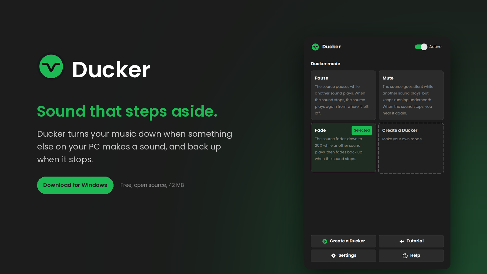
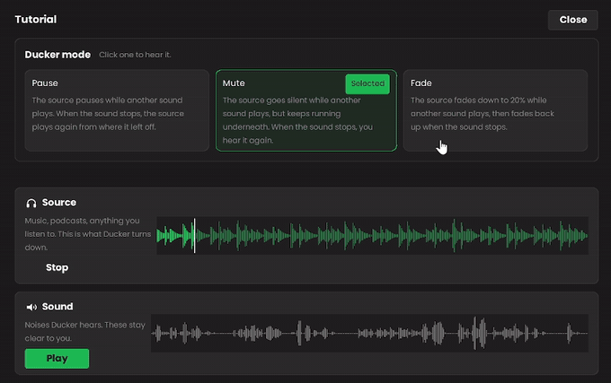
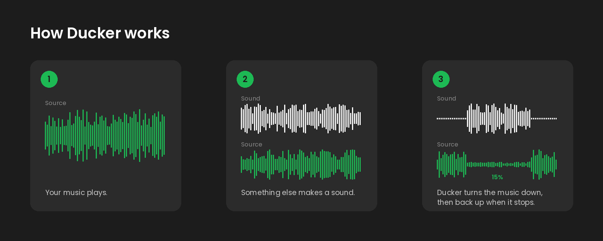

  

  <a href="https://github.com/jacobhammersley/Ducker/releases/latest"><b>Download for Windows</b></a>
  &nbsp;·&nbsp;
  <a href="Ducker%20guide.pdf">Read the guide</a>
  &nbsp;·&nbsp;
  <a href="#four-ways-people-use-ducker">Use cases</a>

## What Ducker is

Ducker is a free, open-source Windows app that automatically lowers the volume of your music when any other sound plays on your PC, and raises it again when that sound stops. It runs in the system tray and needs no attention once it is set up.

In audio terms this is called ducking. Radio stations do it when a presenter talks over a song. Ducker does the same thing on your desktop, for any app or website, without you touching anything.

**In one sentence.** You are listening to Spotify, you open a YouTube video, Spotify drops to 20% while the video plays, and fades back to full when it ends.

  

## How it works

  

Ducker uses three words.

| Word | Meaning |
|---|---|
| **Source** | What you are listening to. Usually music, but it can be a podcast, a film or a game. The source is what Ducker turns down. |
| **Sound** | Any other noise on your PC. A video, a call, a game, a notification. A sound is what makes the source duck. |
| **Duck** | The dip itself. The source gets quieter, pauses or goes silent while a sound plays, then comes back when the sound stops. |

Ten times a second, Ducker reads the volume meter of every app from Windows' own audio mixer, the same one you see in the Volume Mixer. If any app that is not a source and not an exception is making noise, Ducker applies the chosen mode to the source. When the noise stops, it waits one second and reverses it. Nothing is recorded and nothing leaves your PC.

## What you can choose

**Ducker mode** decides what the duck does. There are three built in, and you can make your own.

| Mode | What happens | Good for |
|---|---|---|
| **Pause** | The source stops completely, then carries on from where it left off. | Podcasts and audiobooks, where you do not want to miss anything. |
| **Mute** | The source goes silent but keeps running, so you hear it again wherever it has got to. | Radio and long playlists. |
| **Fade** | The source fades to 20%, then fades back up over a second and a half. This is the default. | Music. |
| **Your own** | Choose the effect, the volume it drops to, the fade speeds in and out, and how loud a sound has to be before anything happens. | Anything the three above do not quite fit. |

**Sources** are the apps and websites Ducker turns down. Spotify, Apple Music and YouTube Music are there from the start. Add any app on your PC by name, or any website by address, for example soundcloud.com.

**Exceptions** are sounds Ducker ignores. They never cause a duck. Discord is one by default, so a message ping does not dip your music.

**Input** makes your microphone count as a sound. Switch it on and talking ducks the source, which is useful for voice chat over music or recording a voice-over. Each microphone has its own sensitivity.

A built-in **Tutorial** plays two recordings, a music loop and a radio announcement, so you can hear a duck happen before you rely on it.

## Four ways people use Ducker

**Editing a video with music in the background.** You are cutting a video in Premiere Pro with Spotify on. Every time you play a clip, its audio counts as a sound, so Spotify ducks while you listen and comes back when you stop. No pause button, and no silence between edits either, because the music is quiet rather than off. Set-up: Spotify is already a source, choose Fade, and raise the fade-out speed if short clips make the music bounce.

**A film and a conversation.** You are watching a film while on a voice call. When either of you talks, the film quietens so you can hear each other, and comes back up when you both go quiet. Set-up: add the app or website you watch films on as a source, switch Input on and tick your microphone, and make sure the call app is not an exception. Fade to around 30% works well.

**Watching videos with music on.** Music is playing while you browse. You open a YouTube video and the music drops out of the way on its own, then fades back when the video ends. Set-up: nothing. This is how Ducker works out of the box.

**Alerts from software over music.** You want to hear every notification from Teams or a build tool without turning the music down all day. Each alert ducks the music for a moment and it comes straight back. Set-up: make your own mode with Fade speed in at Instant, volume at about 30% and Fade speed out at one second, and add any apps whose pings should not count as exceptions.

## Download and install

1. Get `Ducker - Installer.exe` from the [latest release](https://github.com/jacobhammersley/Ducker/releases/latest).
2. Open it and press **Install**. Ducker opens when it is done and the installer closes itself.
3. Windows SmartScreen may warn about a new program it has not seen before. Click **More info**, then **Run anyway**. Ducker is not signed with a paid certificate, which is what causes the warning.

Ducker installs to `AppData\Local\Programs\Ducker` and keeps its settings in `AppData\Roaming\Ducker`. It adds **Ducker** and **Ducker - Uninstall** to the Start Menu and appears in Windows Settings under Installed apps. Uninstalling removes everything.

The [guide](Ducker%20guide.pdf) explains every button and setting with screenshots.

## What it never does

Ducker only moves the per-app volume sliders you can see in Windows' own Volume Mixer. It has no network code and never connects to the internet. It does not record audio, take screenshots or read your files. It does not run as administrator. Its settings are one small text file. You can check all of this in Task Manager, or by reading `ducker.py`.

## Requirements

Windows 10 or 11. About 42 MB. No other software needed.

## Building it yourself

You need Python 3.10 or newer. Run `build.bat`. It installs the libraries it needs, builds `Ducker.exe` with PyInstaller, then wraps it in `Ducker - Installer.exe`. Both end up in the `dist` folder.

`ducker.py` is the app. `setup.py` is the installer and uninstaller. `art` holds the icons, `sounds` the tutorial recordings. It uses pycaw to read and set per-app volume through the Windows Core Audio API, and CustomTkinter for the window.

## Who made it

Jacob Hammersley, a creative strategist and media producer in Bristol. Ducker started as a fix for editing videos with music on, then turned out to be useful for a lot more than that.

## Licence

MIT. See `LICENSE`.
