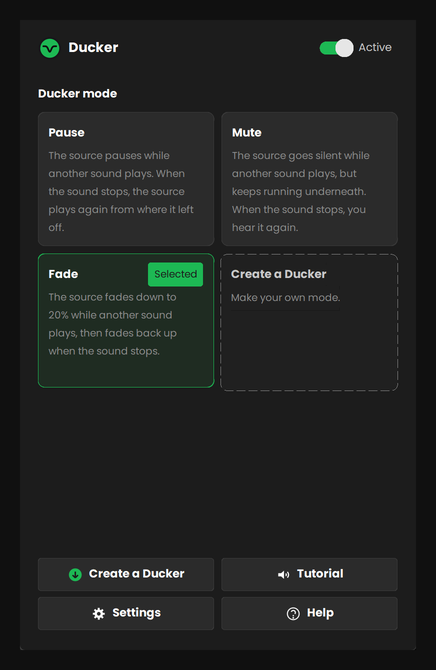

  

<h1 align="center">Ducker</h1>

<h3 align="center">Sound that steps aside.</h3>

Ducker turns your music down when something else on your PC makes a sound, and back up when it stops.

  <a href="https://github.com/jacobhammersley/Ducker/releases/latest"><b>Download the latest version</b></a>
  &nbsp;·&nbsp;
  <a href="Ducker%20guide.pdf">Read the guide</a>

  

Say you are listening to Spotify and you open a YouTube video. The moment the video makes a sound, Spotify drops to 20% volume. When the video ends, Spotify fades back to full. That dip is called a duck.

## Download

Get `Ducker - Installer.exe` from the [latest release](https://github.com/jacobhammersley/Ducker/releases/latest), open it and press Install. Windows SmartScreen may warn about a new program it has not seen before. Click **More info**, then **Run anyway**.

The full guide, with every button and setting explained, is in [Ducker guide.pdf](Ducker%20guide.pdf).

## What it does

* Pick a mode. **Pause** stops the source, **Mute** silences it, **Fade** turns it down to 20%. Or make your own mode with its own volume, speeds and sensitivity.
* Choose your sources. Spotify, Apple Music and YouTube Music are there from the start. Add any app or website.
* Add exceptions, sounds that never cause a duck. Discord is one by default.
* Switch on Input and your microphone counts as a sound too.
* A built-in tutorial plays two recordings so you can hear a duck happen before you rely on it.

## What it never does

Ducker only moves the volume sliders you can see in Windows' own Volume Mixer. It has no network code, does not record audio, does not run as administrator, and keeps its settings in one small text file in your AppData folder. Uninstalling removes everything.

## Building it yourself

You need Windows 10 or 11 and Python 3.10 or newer. Run `build.bat`. It installs the libraries it needs, builds `Ducker.exe`, then wraps it in `Ducker - Installer.exe`. Both end up in the `dist` folder.

The source is in `ducker.py` (the app) and `setup.py` (the installer and uninstaller). The icons are in `art`, the tutorial recordings in `sounds`.

## Licence

MIT. See `LICENSE`.
